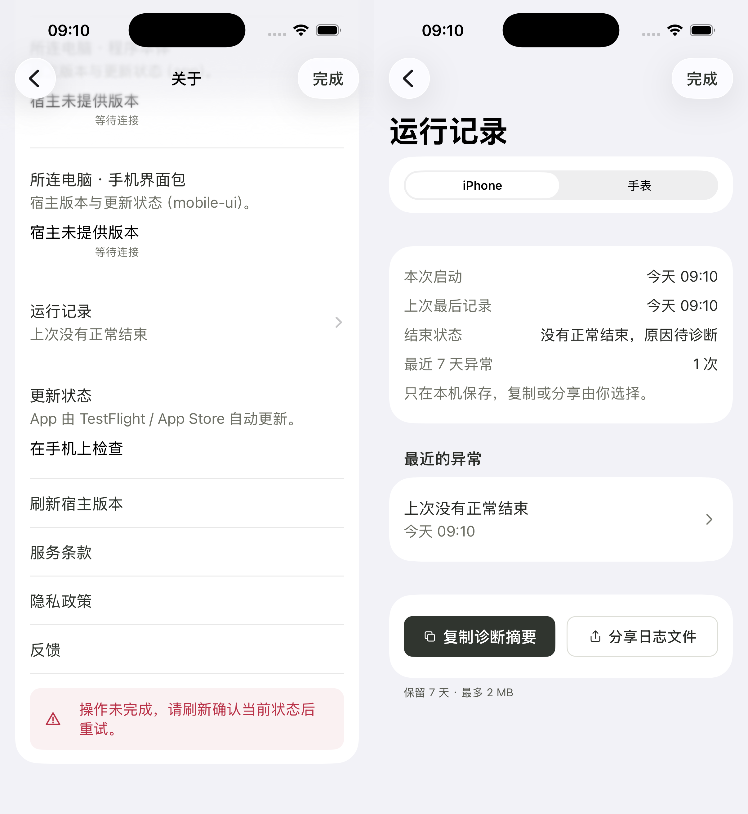
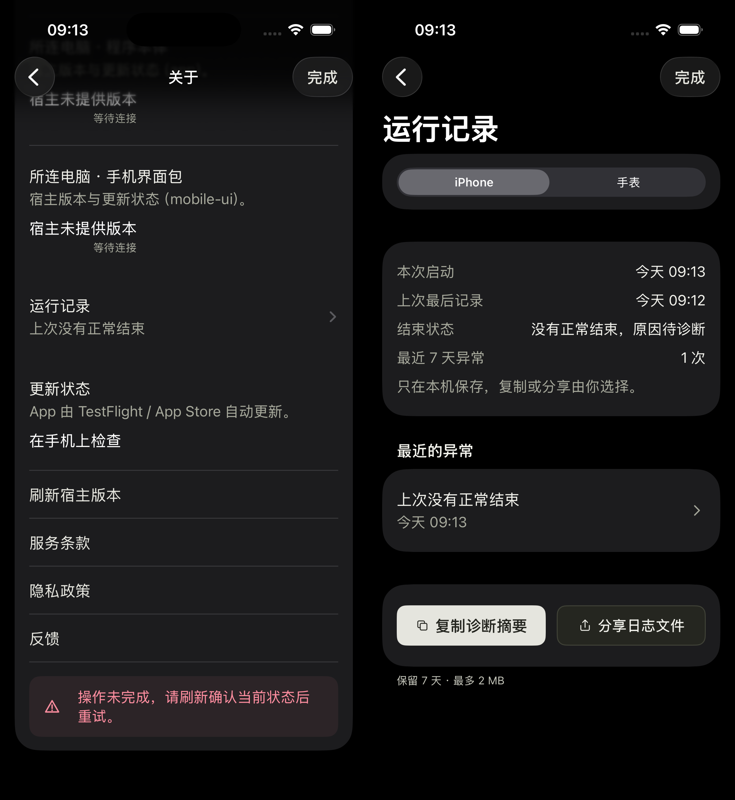
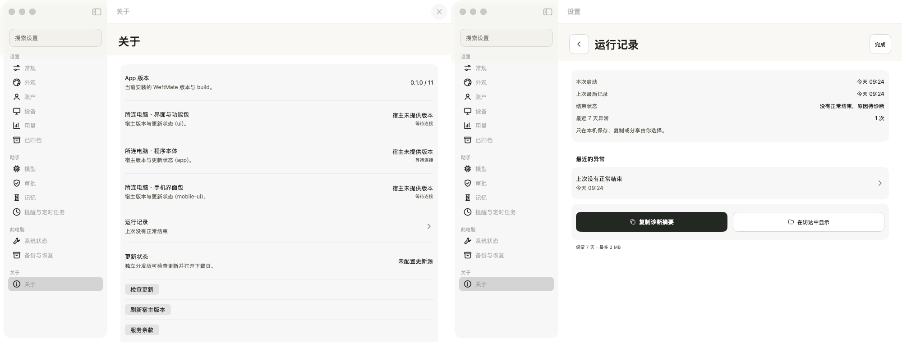
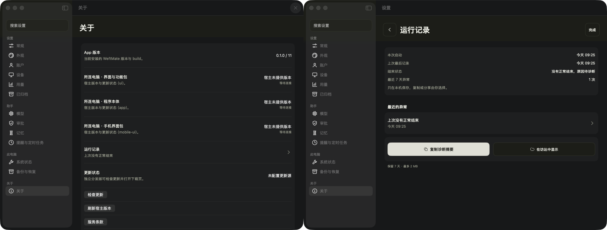

# DIAG-3 / DIAG-3b 苹果运行记录

DIAG-3 的日志功能与字段约定保持不变。本次 DIAG-3b 只返工设置入口、导航、提示条、动作、预览和详情；不改写入、轮转、脱敏、启动标记、MetricKit、系统报告接入、Watch 传送或相应测试断言。没有宿主协议、服务器路由、其它平台或真实模型请求变化。

[字段、隐私与保留策略](fields.md)仍是原功能包的约定。手机 / Mac 7 天、2 MiB；手表 7 天、256 KiB。界面分别写作「保留 7 天 · 最多 2 MB / 256 KB」。

## 界面返工 1–8

1. 关于页入口位于 App / 所连电脑版本行之后，使用同类列表行：标题、同左边线的状态说明、右箭头和整行点击。三种说明是「暂无记录」「上次没有正常结束」「上次正常结束」；读取失败另有明确说明。
2. iPhone 使用设置的同一个 `AppleSettingsRoute` 导航；返回关于，运行记录与详情复用 `SettingsDoneButton` 的「完成」胶囊。背景、卡片和分组使用与关于 / 账户 / 设备相同的原生 grouped Form，主题与 tint 继承已有 AppleTokens。Mac 直接在真实设置窗口详情栏显示，保留关于分类选中态；返回 / 完成使用已有 OutlineActionStyle，内容在标题栏之下。
3. 两个动作等宽并排，完整单行标签：主操作「复制诊断摘要」，次操作手机「分享日志文件」、Mac「在访达中显示」。先打开预览，再由本人确认复制 / 分享 / 访达。读取失败两个动作禁用；只有错误行提供「重试」。进入、前台恢复与已有 Watch 接收发布自动更新页面，不保留大号刷新按钮。
4. 容量用 MB / KB，不出现「2,048 KB」。保留期、字节上限和传送上限的数值未变。
5. 提示放在导航下方的内容区域，复用 InlineNotice；没有独立状态栏背景带。右侧「查看」和「×」都消耗本轮提示，前台恢复不重复弹出。Mac 提示属于 Form 内容，不占标题栏。
6. 异常整行打开详情：发现时间、结束前最后记录、最后动作、前台 / 后台 / 非活动状态、之后可关联的系统诊断、已知类型与位置。系统诊断可能跨多轮，关联明确写作线索；没有位置不伪造。缺少线索显示「没有更多线索」。原始记录通过带箭头的「查看原始记录」展开。
7. 前台未正常结束保留「没有正常结束，原因待诊断」；后台系统回收显示「在后台被系统回收（正常现象）」。列表、详情和预览首页只有今天 / 昨天 / 月日的时分。摘要 / 文件的原始内容也默认收起，只有主动展开后显示 ISO 与秒；确认动作的数据未改变。
8. 行、说明与卡片使用同一左边线；内容间距、字号、圆角、颜色和图标使用已有令牌 / 控件 / 生成资产。原生浅灰 Form 页脚使用已有次文字色，避免弱文字色在灰底上不足 4.5:1。详情和两个预览均有明确的展开与关闭控件。

## 前后对照

「前」保存在 Git 的 `73bf79066`，交付目录不保留旧 PNG 或两套图片。

| 问题 | 前图（上述历史版本） | 当前证据 |
|---|---|---|
| 顶部孤立按钮、缩进分隔线 | iphone-banner-dark.png | iphone-about-empty-dark.png、iphone-about-records-dark.png、iphone-about-normal-dark.png |
| 背景和完成按钮不同 | iphone-records-dark.png | iphone-records-dark.png、iphone-about-and-run-log-dark.png |
| 三个竖排动作 | iphone-records-light.png | iphone-records-light.png、iphone-read-failure-light.png |
| 状态栏出现另色背景带 | iphone-banner-dark.png | iphone-banner-dark.png、iphone-banner-light.png、iphone-banner-dismissed-dark.png |
| 异常点击无下文 | iphone-records-light.png | iphone-detail-light.png、iphone-detail-raw-light.png |
| 缺少打开的预览 | 无 | iphone-summary-preview-light.png、iphone-file-preview-light.png、iphone-system-share-light.png |
| Mac 另开大页面弹层 | mac-records-dark-diag3-records.png | mac-records-dark.png、mac-about-and-run-log-dark.png |

浅 / 深各有完整对应文件；[screenshots.json](screenshots.json)列出每张图的名称、像素尺寸、主题和来源。

## 截图矩阵与并排图

- iPhone 关于入口：`iphone-about-{empty,records,normal,read-failure}-{light,dark}.png`。
- 提示与关闭：`iphone-banner-{light,dark}.png`、`iphone-banner-dismissed-{light,dark}.png`；Mac 同名 `mac-` 前缀。
- 页面三态及正常结束补充：`{iphone,mac}-{empty,records,read-failure,normal}-{light,dark}.png`。
- 摘要首页 / 原始内容：`iphone-summary-{preview,raw}-{light,dark}.png`；Mac 用 `mac-summary-{preview,raw}-{empty,records,normal}-{light,dark}.png`。
- 文件首页 / 原始内容：`iphone-file-{preview,raw}-{light,dark}.png`，及 `iphone-empty-file-preview-{light,dark}.png`；Mac 用 `mac-file-{preview,raw}-{empty,records,normal}-{light,dark}.png`。
- 真正打开的手机系统分享面板：`iphone-system-share-{light,dark}.png`。
- 详情 / 原始展开：`{iphone,mac}-detail-{light,dark}.png`、`{iphone,mac}-detail-raw-{light,dark}.png`。
- 手表栏及错误详情：`iphone-watch-{light,dark}.png`、`iphone-watch-detail-{light,dark}.png`。
- 并排对照：`{iphone,mac}-about-and-run-log-{light,dark}.png`，左关于、右运行记录。保持两张原图完整原生分辨率，不裁切、不遮罩、不补画。

所有场景为合成账号 / 数据。交互由原生 XCUITest 与 Mac App 内 AX 验证。iPhone 交付图是在 XCTest 会话结束后启动同一 App 的合成场景入口，以 simctl 抓实际完整显示画面；此模拟器的 XCTest 会话会隐藏底部指示条，不能把其附件声称为带指示条原图。合成入口复用真实设置、详情与同一预览 / 导出动作，日志状态来自隔离 RunLog actor 的实际持久标记。Mac 只捕获自己进程的真实设置窗口与原生预览面板，包含标题栏。

## 验证、崩溃盘点与边界

最终数字与结果见 [validation.json](validation.json)、[mac-e2e.json](mac-e2e.json)、[crash-check.json](crash-check.json)、[cleanup.json](cleanup.json)。Swift 运行记录 20 项测试与 Watch 强制结束断言未修改。Mac 不启动不可用的 XCUITest automation mode，不重试授权、不更改系统设置；原生界面使用已有 App 内 AX。

本轮开工的产品报告基线 11（Mac / Phone / Watch；另有旧 UITest Runner 报告 3 份，初次粗筛共 14，已纠正口径）。本轮收到一个新文件，但它的崩溃捕获时间为 19:48:43，早于本轮 20:52:37 开工；报告头的交付时间为 20:53:40。报告文件新增数与本轮新崩溃数分别列出，绝不把新增文件写成零。没有删除报告，没有关闭既有 Mac 崩溃对话框。

原 DIAG-3 的历史功能证据（字段、合成样本、传送、性能与初轮失败）保留。真实 MetricKit 延迟送达、真实后台回收 / 断电、Watch 长期断连和真机免费签名等仍是原功能包的真机边界，本次界面返工不重新宣称完成这些验收。Mac 文件预览已打开并核对确认控件；不自动打开访达或向任何接收方发送文件。
