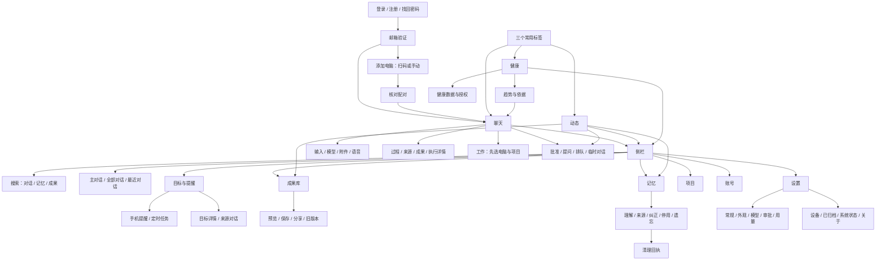

# WeftMate iPhone 界面设计

2026-10-27 · IOS-UI-DESIGN-2 · 本人已认可整套设计，本次按意见改为系统白底和按钮旁小菜单。此包交付浏览器原型和移植说明；没有修改 Swift 或安卓代码，没有完成原生编译、实机验收或健康授权。

直接打开 [prototype/index.html](prototype/index.html)。无需服务、网络或构建。宽屏左边可直达每页和切换示例状态；手机画框为 **393 × 852**，右上角切深浅色。窄屏只保留手机画面。所有账号、消息、健康数据、文件和金额均为合成示例，刷新重置。表单不保存凭据，只有「保存文件」下载合成文本；相机、通知、系统分享等入口用说明代替系统调用。

先体验这几条路：输入框加号 → 文件/相机/照片小菜单 → 点空白处关闭；模型名 → 小菜单切换模型；全部对话 →「…」→ 筛选/排序；设置 → 外观 → 深色。原有聊天流式、标签保留、侧栏、健康趋势、记忆纠正/遗忘和登录配对仍可体验。填写内容的底部弹层保留下拉关闭，桌面导览可播放流式、查看待批准、待回答、排队消息。

## 设计决定

底部推荐 **聊天 / 动态 / 健康**。这是基于产品任务的频率假设，并非使用统计：聊天随时发生；动态用于及时处理批准、问题、失败和完成回执；健康适合每天快速查看。目标、成果和记忆通常在回顾、查找或管理时打开，收进侧栏。本人可以在这份原型上确认这个取舍。

侧栏没有第二排「聊天 / 动态 / 健康」页面导航。「主对话」是具体的对话定位，「全部对话」是列表，二者都属于聊天空间，不再把五个标签复制进去。目标与手机提醒放在同一页的不同分区；账号和设置固定在侧栏底部。任何页面左上返回都沿进入路径回去，不能一律跳回主对话。

视觉沿用 D124 和电脑端此次重做的方向：中性石墨色、轻分隔线、明确的文字起点、较紧凑的行距。回答直接在画布上阅读，过程收成一行；输入框是唯一持续出现的操作容器。移动端保留至少 44 pt 触控面积，不照搬电脑的三列工作区。健康颜色严格采用已有健康令牌，颜色不独自表达状态。

当前 `PhoneTab` 的五项和 D56 记录的是原生现状；本包提出三项的完整设计，等本人确认后的 SwiftUI 包再改枚举与原生导航。没有借原型把冻结功能重新开放。

## 导航结构



三个标签各有独立的导航栈、滚动位置和草稿。比如健康打开睡眠详情，切去聊天再回来，仍在睡眠详情；再次点当前标签才回该标签首页。侧栏是当前空间上方的模态导航，选择后关闭，背景保留。原型用常驻页面节点模拟状态保留，不在标签切换时替换整块根内容。

## 布局与组件，逐页交接

路径均相对 `apps/apple/`。本文的「改」是下一包建议，本包未改这些文件。

| 原型页面 | 布局、重点状态 | Swift 入口与建议改动 |
|---|---|---|
| `chat` | 54 pt 状态区 + 52 pt 导航；过程在上、回答在下；轻用户气泡；底部输入框与三标签 | `iOS/PhoneStandaloneView.swift`、`UI/MainChatView.swift`、`UI/ConversationView.swift`：统一手机聊天外壳，保留各模型的命令与状态边界；移除开侧栏时让内容 `opacity` 归零的做法 |
| 侧栏 | 328 pt 宽，搜索置顶，新对话、对话定位、长期内容、项目、底部账号；中间独立滚动 | `UI/WeftMateRootView.swift` 的 `PhoneChatWorkspace`、`iOS/PhoneStandaloneView.swift` 的本机侧栏：同一份导航配置；删除禁用重复入口 |
| `conversations` / `search` / `history` | 对话与工作过滤、组别、状态、搜索结果分类、按日期定位；无结果说明恢复路径 | `UI/WeftMateRootView.swift`、`UI/SessionActions.swift`、`UI/MainChatView.swift`、`UI/MainChatPositionTracking.swift`：复用查询与定位行为，只换呈现 |
| `work` / `projects` | 首条之前选电脑、项目与读写范围；工作后不切回对话；离线可暂存 | `iOS/PhoneWorkAndChat.swift`、`UI/ProjectsView.swift`、`UI/ComputerControls.swift`、`iOS/PhoneOfflineWork.swift`：手机用推进页面选择，不挤在输入区 |
| `resources` / `task` | 成果、来源、过程三节；执行步骤可展开输出和复制，返回原消息 | `UI/MainChatResourcesView.swift`、`UI/ConversationResourcesView.swift`、`UI/ConversationTimelineView.swift`：手机完整子页；保留成果版本、来源锚点及任务交互 |
| 输入区 / 附件菜单 | 草稿一至五行，附件在草稿上方；加号与模型使用按钮旁小菜单，位置固定；有回复时同一主操作位停止 | `UI/MainChatView.swift::composerTools/legacyModelSelection` 保留 `Menu`；系统选图、相机、文件权限与错误继续 `UI/ComposerMedia.swift`、`iOS/PhoneAttachmentInput.swift`、`PhoneAttachmentBlock.swift`、`PhoneStandaloneMedia.swift` 的实现 |
| 批准 / 提问 / 队列弹层 | 正文显示影响，当前批准只一项；提问选项和补充文本；队列可改或撤回 | `UI/ConversationApprovalBar.swift`、`ConversationQuestionBar.swift`、`TaskInteractionView.swift`、`iOS/PhoneDecisionCards.swift`：主聊天中输入框上方保留待处理摘要，点击展开；原型由动态/导览进入完整弹层 |
| `activity` | 待处理优先，其次完成、回顾、记忆变化；全部 / 未读 / 待处理；点击回到实际来源 | `iOS/PhoneFeaturesViews.swift::PhoneActivityView`、`DailyHealthViews.swift`：稳定行列表，替代等高大卡；保持分页和已读语义 |
| `health` | 日期、更新时间、恢复、压力/电能/负荷、睡眠分期、身体指标、活动/月历、解读入口 | `iOS/HealthPageView.swift`、`HealthMetricsView.swift`、`HealthScoreRangeBar.swift`：主次分明的纵向列表；没有数据用破折号与原因 |
| `health-detail` | 7/14/30/60 天趋势、个人基线、点按读值、深夜使用叠加、依据与缺失、按需 AI 分析 | `iOS/HealthPageView.swift::HealthDetailView/HealthTrendChart/HealthFormalBasis`、`HealthPageNavigation.swift`：保留现有指标/算法；睡眠为截图代表，所有指标入口均可打开 |
| `health-settings` | 读取开关、项目、云端范围、AI 分析、频率、摘要、删除与回执 | `iOS/HealthSettingsView.swift`、`DailyHealthViews.swift`、`HealthAISettingsRow.swift`、`PhoneLocalHealthView.swift`：授权与设置共用明确的使用范围；本机无电脑状态只展示已有测量 |
| `goals` / `goal-detail` | 手机提醒、定时任务、进行中任务、长期目标、已完成；详情有下一步和来源 | `iOS/PhoneFeaturesViews.swift::PhoneGoalsView`：长期目标和执行任务视觉分区，保持暂停/恢复/完成/归档的不同含义 |
| `reminders` / `schedules` | 通知能力说明、当地时间、修改/完成/删除；定时任务暂停/恢复/立即运行/来源与最近执行 | `iOS/PhoneLocalRemindersView.swift`、`PhoneReminderNotifications.swift`、`UI/SettingsView.swift`：同一任务实体只有一个编辑入口，其他页面链接过去 |
| `library` / `library-detail` | 搜索、类型过滤、日期分组、预览、系统分享、下载、版本与来源 | `iOS/PhoneLibraryView.swift`、`UI/ReplyArtifactList.swift`、`TimelineArtifactCard.swift`：使用原生预览和分享能力，不把真实文件转换成网页示意 |
| `memory` / `memory-detail` / `memory-cleanup` | 读电脑副本，来源、纠正、停用、范围遗忘与清理回执；离线只读 | `iOS/PhoneMemoryView.swift`、`UI/MemoryWorkspaceView.swift`：统一设计；以 D119 当前手机窗口语义决定可用操作，不能恢复手机独立形成长期记忆 |
| `settings` | 账号卡 + 搜索 + 分组列表推进子页；没有桌面式双栏 | `UI/SettingsView.swift`、`Packages/WeftMateCore/Sources/WeftMateCore/AppleSettings.swift`：修好手机类别实际可达性，含 `system`；内容滚动、不套整页弹层 |
| `general` / `appearance` | 回复中发送规则、回顾、连接；深浅跟随系统、石墨、系统字号、减少动态效果 | `UI/SettingsView.swift`、`UI/WeaveTheme.swift`：消费令牌与系统辅助功能，设置即时生效并保留页面 |
| `models` / `model-edit` | 服务与模型分层；地址、密钥、读取模型、能力/单价、主/后台模型、连接失败重试 | `UI/ModelServicesSettings.swift`、`ModelServiceControls.swift`、`iOS/PhoneProviderPreset.swift`：保持每服务自动列模型与按对话选择 |
| `usage` / `approvals` | 月份、费用、缺单价单列、排行/上限；新对话默认审批与二次核对 | `UI/UsageView.swift`、`AccountUsageBar.swift`、`ApprovalModeControl.swift`：手机逐行设置；不把未知当作零 |
| `account` / `change-email` / `change-password` / `devices` | 换绑验证、改密、其他设备退出、注销验证；电脑改名/切换/移除 | `UI/AccountSettingsView.swift`、`CloudDevicesView.swift`、`DevicesView.swift`、`PhoneAccountMenu.swift`：保留账号边界和二次确认；原型不执行这些真实操作 |
| `archived` / `system` / `about` / `diagnostics` / `legal` | 恢复/删除；连接与服务状态；版本与更新、条款、运行日志预览/导出/清空 | `UI/SettingsView.swift`、`RunLogView.swift`、`AuthView.swift`：手机不呈现电脑专用备份/恢复或重启按钮；合法条款沿用正式文档 |
| `login` / `register` / `recovery` / `verify` | 邮箱验证码/密码、注册、找回、密码显隐/强度、六位验证与重发冷却；本机可先聊 | `UI/AuthView.swift`、`CloudAccessView.swift`、`CloudLoginModel.swift`：不同验证目的保留各自路由，不因统一视觉丢失恢复密码流程 |
| `pairing` / `pair-confirm` | 相机权限、扫码、手动地址/码、核对两边代码、取消和稍后添加 | `iOS/PairingScannerView.swift`、`UI/DevicesView.swift`、`CloudDevicesView.swift`：扫描后先确认设备身份，连接失败有重试和继续手机聊天 |

## 聊天行为约定

- **流式文字**：先显示已有字，再将新字按扩展字素簇追加（不能拆 emoji、组合字符）；28 ms/字素是模拟目标，每帧最多追上 8 个。每批文字只淡入 220 ms，不重排已有整段，不对整段做打字动画。真实模型 token（文字片段）的到达速度不受 UI 强行拖慢；落后时批量追上。代码块/表格先稳定容器，完成后解析对应块，不能每字重建整个 Markdown（标记文本）树。
- **过程**：发送时创建稳定身份的一轮过程行；运行时展开，完成后收成一行。过程在回答上方，工具原始输出点开才看；不显示「参考了 N 条记忆」。批准和提问保留其原提交身份，丢失回执显示「核对并继续原提交」。
- **跟随**：距离底部 ≤48 pt 才自动跟随；用户上滑立即停止。新文字到达不抢滚动位置；浮动「回到最新回复」恢复跟随。停止不删已经收到的字；失败保留回答并在该轮显示「重试」，不会只有空白。
- **发送/停止/排队**：主操作位固定。回复中无草稿显示停止，有新草稿显示排队发送；排队消息可修改或撤回，已经处理的消息不可编辑重发。语音完成后回到草稿。建议点选只填草稿，不直接发送。
- **键盘**：原生 `safeAreaInset(edge:.bottom)` 跟随键盘，避免内容和输入框各移动一次。输入时临时收起标签栏，收起键盘后原位恢复。浏览器原型用实际 textarea（多行输入框），未仿造 iOS 键盘；键盘交互、中文输入法候选与焦点切换必须在真机验。

## 小菜单、浮窗与底部弹层

短选择贴着触发按钮打开：加号的文件/相机/照片、模型、对话与消息「…」、筛选、排序、分组、项目、审批模式、保留时间和短确认。菜单宽 276 px，在按钮上方或下方按空间避让，离按钮 8 px；贴近屏幕边缘时横向移入可见区。没有整页变暗或底部拖柄；点击外部、Escape（退出键）关闭，关闭后焦点回原按钮，方向键选择菜单项。选择操作后收起；菜单内的开关保持原位。

日期和带少量说明的短确认用 `popover`（按钮旁浮窗）；日期保持原生 `.popover` 与 `.presentationCompactAdaptation(.popover)`，窄屏也不自动变成上拉栏。嵌套菜单和短确认沿用原按钮的位置；从菜单进入重命名、新建分组/项目等表单后，改为底部弹层，关闭仍回到原按钮。

需要输入内容或完整阅读的内容才用 `.sheet`（底部弹层）：新建/修改提醒、重命名、新建项目、手动配对、模型档案、批准影响详情、提问补充、完整遗忘范围与长说明。页内短筛选分段可以保留；额外筛选/排序在全部对话右上「…」里。原生选择文件、照片和分享继续使用系统选取器，不用原型小菜单代替权限流程。

SwiftUI（苹果界面框架）沿用现有写法，以下是移植示意，非本包新增的原生代码。参考 [Menu](https://developer.apple.com/documentation/swiftui/menu) 与 [presentationCompactAdaptation](https://developer.apple.com/documentation/swiftui/view/presentationcompactadaptation(_:))。

```swift
Menu {
    Button("文件", action: chooseFile)
    Button("相机", action: takePhoto)
    Button("照片", action: choosePhoto)
} label: {
    Image(systemName: "plus")
}

Button("选择日期") { choosingDate = true }
    .popover(isPresented: $choosingDate, attachmentAnchor: .rect(.bounds)) {
        DatePicker("选择日期", selection: $chosenDate, displayedComponents: .date)
            .datePickerStyle(.graphical)
            .padding()
            .presentationCompactAdaptation(.popover)
    }
// 短确认同样锚定触发按钮的 popover；带输入的表单继续 .sheet。
```

## 动效令牌与实现

原型继续用仓库五档：130 / 220 / 320 / 420 / 640 ms；四曲线：`ease-out = cubic-bezier(.16,1,.3,1)`、`ease-in-out = cubic-bezier(.4,0,.2,1)`、`ease-in = cubic-bezier(.4,0,1,1)`、`linear`。不另造一套系统。下表是设计目标，**并非声称苹果系统的私有精确参数**；系统导航优先采用系统动画。

| 场景 | 时长 / 曲线 | 属性与中断规则 | SwiftUI 实施建议 |
|---|---|---|---|
| 推进 / 返回 | `dur-3` 320 ms / `ease-out` | 新页 X 从 100% 到 0，旧页到 −25%；返回反向；背景不变白 | 每标签 `NavigationStack(path:)`，系统交互返回优先；自定义过渡用 `.transition(.move(edge:.trailing))`，不要用覆盖手势破坏系统返回 |
| 标签切换 | `dur-3` 320 ms / `ease-out` | 内容 Y 6→0，opacity .45→1；旧内容保留直到新内容可见 | `TabView(selection:)` 保活，轻 `.opacity`；选择底形可 `matchedGeometryEffect`，只动选中指示，不搬整个内容树 |
| 侧栏 | `dur-4` 420 ms / `ease-out` | X −328→0；背景遮罩 opacity 0→1；当前页仍渲染 | 自定义 `ZStack` + `.transition(.move(edge:.leading))`；跟手用 `DragGesture`，释放 `.interactiveSpring(response:0.42,dampingFraction:0.88,blendDuration:0.08)` |
| 侧栏手势取消 | `dur-3` 320 ms / `ease-out` | 前缘 24 pt 内开始；位移 96 pt 以上提交，其余回弹；子页边缘优先返回 | 实机加速度预测阈值；不劫持列表竖滑和控件拖动。VoiceOver（旁白）保留开关按钮 |
| 小菜单 / 日期 / 短确认 | `dur-2` 220 ms / `ease-out` | 以按钮方向为缩放原点，scale .92→1、opacity 0→1；关闭反向，重开可中断；无整页遮暗 | 简短动作沿用 `Menu`；日期与短确认 `.popover` + `.presentationCompactAdaptation(.popover)`；系统控件采用系统动画 |
| 底部弹层 | `dur-4` 420 ms / `ease-out` | Y 100%→0，遮罩同步；拖柄下拉 >96 pt 关闭 | `.sheet`、`.presentationDetents([.medium,.large])`、`.presentationDragIndicator(.visible)`；系统弹层跟手优先；有未保存表单时保留草稿或确认丢弃 |
| 折叠过程 | `dur-2` 220 ms / `ease-in-out` | 高度与内容裁切、箭头旋转；不淡掉回答 | `DisclosureGroup` + `.animation(.easeInOut(duration:0.22),value:expanded)`；不要给整条消息施加 `.id` 重建 |
| 列表增 / 删 | `dur-2` 220 ms / `ease-out` / `ease-in` | 增加 Y 8→0、opacity 0→1；移除 X 0→−24、opacity 1→0，然后收口 | 稳定 ID 的 `ForEach`、`.transition(.asymmetric(insertion:...,removal:...))`；状态回执后才移除 |
| 流式尾字 | 28 ms/字素调度；淡入 `dur-2` 220 ms / `ease-out` | 只改变新文字 opacity .3→1；不移动整段；停止取消后续帧 | `TimelineView` 或节流合并发布；按字素边界更新，完成段落固定身份 |
| 跟随最新 | `dur-3` 320 ms / `ease-out`，流式逐帧贴底不反复起动画 | 只在主动回最新时滚动动画；后台更新不抢位置 | `ScrollViewReader` / `scrollPosition` + 阅读位置状态；以用户拖动为停止跟随依据 |
| 按压反馈 | `dur-1` 130 ms / `ease-out` | 轻透明度反馈；不缩放整个页面 | `ButtonStyle`；原生轻触觉只在明确完成或切换时使用，不每个 token 震动 |
| 深浅切换 | 即时换令牌，无全页渐隐 | 维持滚动、草稿、焦点、已收到文字 | `.preferredColorScheme`，避免给根视图加颜色模式 `.id` |
| 减少动态效果 | 原型 1 ms，原生取消位移 | 保留新状态、文字和焦点，不留隐藏内容 | `accessibilityReduceMotion`；去掉位移/弹簧，必要时 ≤130 ms 淡化；读取 `accessibilityReduceTransparency` 降低磨砂 |

原生推进与弹层遵循 [Apple 的导航说明](https://developer.apple.com/videos/play/wwdc2022/10001/) 和 [Tab bars 指南](https://developer.apple.com/design/human-interface-guidelines/tab-bars)；自定义侧栏的弹簧 API 见 [interactiveSpring](https://developer.apple.com/documentation/swiftui/animation/interactivespring(response:dampingfraction:blendduration:))。原生系统栏材质会随系统版本与辅助功能变化，遵循 [Adopting Liquid Glass](https://developer.apple.com/documentation/technologyoverviews/adopting-liquid-glass)，不要用浏览器画框替换系统栏。这里借的是布局与交互，默认没有大面积装饰性玻璃。

## 功能对照：现有能力放在哪里

按当前工作副本 `e30ce39e4` 的 iOS 与共用 UI 代码核对。代码保留的旧入口与当前规则冲突处单列，不把历史能力误报为新产品承诺。一个表格行可以涵盖同一状态机的关联动作。

| 现有功能 / 状态 | 新位置与行为 | 依据 |
|---|---|---|
| 原底部聊天、动态、健康、目标、成果库 | 前三项留底部，后两项进侧栏，无禁用重复按钮 | `PhonePresentation.swift::PhoneTab`、`WeftMateRootView.swift` |
| 主对话、旁聊、手机本地对话、多电脑对话 | 侧栏「主对话 / 全部对话」，按对话/工作和电脑归属显示 | `PhoneStandaloneView.swift`、`WeftMateRootView.swift` |
| 新对话、新工作、选电脑、选项目、只读/可写 | 新建小菜单 → 工作选择页；首条之前选定；创建项目表单用底部弹层 | `PhoneWorkAndChat.swift`、`ProjectsView.swift` |
| 对话置顶、未读、重命名、分叉、分组、归档、删除 | 对话行可见更多按钮 → 小菜单；重命名填写用底部弹层；归档在设置恢复 | `SessionActions.swift`、`MacSessionMenu.swift` 的共用语义 |
| 临时对话、不形成记忆、是否召回、1/7/30 天或永久保留 | 新建 / 对话操作 → 临时对话；顶部持续标记 | `TemporaryChatMenu.swift` |
| 原话日期定位、前后历史分页、全文搜索、来源位置返回 | 搜索 → 按钮旁日期浮窗 → 历史；详情返回恢复阅读锚点 | `MainChatView.swift`、`MainChatPositionTracking.swift` |
| 发送、流式、停止、复制、重新生成、失败重试 | 聊天轮次与固定输入区；保留已收到内容 | `PhoneStandaloneView.swift`、`MainChatView.swift` |
| 输入保留、排队、引导、编辑/撤回未处理消息 | 输入框与排队弹层；默认规则在常规设置 | `ConversationSendState.swift`、`AppleAppModel.swift` |
| 下一步建议、引用、从消息开旁聊 | 回答下方；建议填草稿，旁聊保留来源 | `MessageActionsPresentation.swift`、`MainChatView.swift` |
| 过程展开、工具输出、Markdown、复制全文/原始内容 | 过程行 → 执行详情；答案与过程分离 | `ConversationTimelineView.swift`、`MessageMarkdown.swift` |
| 批准/拒绝、一次允许/此类允许、风险说明、待处理计数 | 输入框上方摘要 + 完整弹层；同一时刻一项 | `ConversationApprovalBar.swift`、`TaskInteractionView.swift` |
| 提问选项、自由回答、已提交、待核对原提交 | 提问弹层；结果回到该轮，丢回执继续原身份 | `ConversationQuestionBar.swift`、`PhoneDecisionCards.swift` |
| 拍照、图库、多文件、图片/文件预览、移除、能力限制、权限错误 | 输入框加号；系统选取器；附件草稿条；拒绝相机仍可文件 | `PhoneAttachmentInput.swift`、`PhoneStandaloneMedia.swift` |
| 语音转写、完成/取消、键盘收起 | 输入框语音 → 转写确认回草稿；原生键盘工具栏 | `ComposerMedia.swift` |
| 模型服务增改删、预设、自定义地址、密钥、刷新模型 | 设置 → 模型服务 → 编辑；错误在原位重试 | `ModelServicesSettings.swift`、`PhoneProviderPreset.swift` |
| 每服务模型选择、图片能力、深入思考、主/后台模型、单价 | 输入框模型小菜单；设置模型档案表单 | `ModelServiceControls.swift`、`SettingsView.swift` |
| 手机独立聊天、电脑离线继续聊、加密待同步、重连 | 聊天顶部状态、原话交接弹层、设备页 | `PhoneStandaloneModel.swift`、`OfflineChatView.swift` |
| 离线电脑任务暂存与取消、模型转交前核对 | 输入框工作模式 → 离线暂存；等待任务在目标查看/取消 | `PhoneOfflineWork.swift`、`PhoneWorkAndChat.swift` |
| 电脑收到原话 / 电脑就绪 / 模型可用 / 记忆形成 / 副本时间 | 原话交接 + 系统状态分别显示；不把接收当形成 | 当前 D119 与 Apple 手机窗口工作 |
| 动态全部/未读/待处理、标已读、详情、更多分页 | 动态标签；摘要行和动作保留 | `PhoneFeaturesViews.swift::PhoneActivityView` |
| 动态跳设置、来源对话、成果、记忆；每周洞察、记忆新增/待核对摘要 | 动态行 → 具体目的页；回顾弹层列来源 | 同上、`DailyHealthViews.swift` |
| 任务进行中、最近执行、来源、状态 | 目标 → 执行详情；动态可直达 | `PhoneGoalsView`、`TaskInteractionView.swift` |
| 定时任务/提醒暂停、恢复、立即运行、删除、时区和下次时间 | 目标 → 定时任务；设置为同实体链接 | `PhoneGoalsView`、`SettingsView.swift` |
| 长期目标进度、完成、移出列表、来源对话 | 目标详情 → 更多；移出与完成不混淆 | `PhoneGoalsView` |
| 手机提醒新建、修改、完成、删除、来源、通知拒绝与去设置 | 目标 → 手机提醒；提醒编辑弹层与通知说明 | `PhoneLocalRemindersView.swift` |
| 成果搜索、文档/表格/图片/代码/其他过滤、分页 | 成果库；原生保持全类型菜单与分页 | `PhoneLibraryView.swift` |
| 成果原生预览、保存/分享、旧版本、来源、回到回答 | 成果详情 → 操作 / 版本；引用返回锚点 | `ConversationResourcesView.swift`、`ReplyArtifactList.swift` |
| 记忆类别、搜索、更多、详情、来源证据、纠正、停用 | 侧栏记忆 → 详情；离线只读，连接后管理 | `MemoryWorkspaceView.swift` |
| 删除来源、范围遗忘、操作不确定核对、存储清理重试 | 记忆详情 → 范围确认 → 遗忘进度，回执未到不报完成 | `MemoryWorkspaceView.swift`、`MemoryWorkspaceModel.swift` |
| 旧代码的手机记忆加一条/修改/置顶/全忘、现在交/稍后交 | **旧入口审计项**：当前 D119 要求手机不独立形成记忆；新稿以电脑记忆纠正/范围遗忘和原话交接承接。旧版迁移提醒保留到交接完成，不能在新稿重新开放独立手机长期记忆 | `PhoneMemoryView.swift`；实施前核对 Apple 手机窗口包的最新合并结果 |
| 恢复、睡眠、活动负荷、压力、电能、体能年龄 | 健康概览 → 各指标趋势 / 依据 | `HealthPageView.swift`、`HealthMetricsView.swift` |
| HRV、静息心率、呼吸、血氧、手腕温度、缺测与基线不足 | 健康身体指标 → 详情，缺测显示明确空态 | 同上、`HealthFormalBasis` |
| 睡眠分期/起止、深夜电脑使用、最后发消息时间、活动步数/能量/运动、月历 | 健康睡眠/活动段与详情；仍使用设备本地时间 | `HealthPageView.swift` |
| 趋势 7/14/30/60 天、个人常见范围/平均、图表按住读值、叠加使用时间 | 趋势页；原生图表沿用 Swift Charts（苹果图表） | `HealthTrendChart` |
| AI 今日/分项解读、依据、开启/关闭、失败再试、接着问 | 健康 → 分析弹层 / 详情 → 草稿 | `HealthAnalysisRow`、`HealthAISettingsRow.swift` |
| 本机 HealthKit 读取、授权/追加授权、拒绝仍看已有 | 健康空态 → 读取项目；不伪造系统授权结果 | `PhoneLocalHealthView.swift`、`HealthSettingsView.swift` |
| 读取项目、健康总开关、云使用范围、设备指标不进云、每日摘要、自评频率 | 健康数据子页；频率保留但标明询问未开放 | `HealthSettingsView.swift`、`DailyHealthViews.swift` |
| 删除健康摘要并停止读取、远端删除待重试、原始健康样本保留 | 健康数据 → 删除确认；状态继续可见 | `HealthSettingsView.swift` |
| 设置搜索、常规排队/引导、回顾、外观深浅/系统字号 | 设置列表 → 分类子页 | `SettingsView.swift`、`AppleSettings.swift` |
| 默认审批五模式、二次模型复核 | 设置 → 审批；既有对话在输入区调整 | `SettingsView.swift` |
| 用量/费用、月份/排行/上限、缺单价 | 设置 → 用量；原生接回全部数据项 | `UsageView.swift`、`AccountUsageModel.swift` |
| 账号改密/换绑验证/其他设备退出/注销/当前退出 | 账号与安全 → 对应子页与确认 | `AccountSettingsView.swift` |
| 设备列表、新设备提醒、电脑改名/移除/多电脑/首次验证/重试 | 设备页与配对流程，未认证保留等待状态 | `CloudDevicesView.swift`、`DevicesView.swift` |
| 版本、手机分发更新、电脑版本、运行日志/导出/清空、条款 | 关于 → 运行记录 / 条款；状态查看系统页 | `SettingsView.swift`、`RunLogView.swift` |
| 密码/验证码登录、注册、找回、显隐/强度、冷却/重发、首次设备验证 | 登录各子页；错误原位说明，不重置邮箱 | `AuthView.swift` |
| 扫码、相机拒绝、手动地址/码、配对确认、取消、稍后添加 | 添加电脑 → 扫描/手动 → 核对身份 | `PairingScannerView.swift` |
| 系统状态、后台模型回退只读说明 | 设置 → 系统状态，手机不提供重启操作 | `SettingsView.swift`、`AppleSettings.swift` |
| 电脑专有开机自启、托盘、备份/恢复、Finder 打开等 | 不属于现有 iPhone 能力；留在电脑，不添加不可用按钮 | `#if os(macOS)` 与 `desktopOnly` 分支 |

## 令牌与资源

[tokens.json](../tokens/tokens.json) 仍是基础；[ios-prototype.json](../tokens/ios-prototype.json) 是**待确认的 iOS 增量**，不进入现有产品生成器，避免影响并行的电脑端工作。原型的 [generate-assets.mjs](prototype/generate-assets.mjs) 从两者生成 [tokens.css](prototype/tokens.css)，并从 `design/icons/ui/` 生成本地内联图标 [assets.js](prototype/assets.js)，保证 `file://` 直接打开也不依赖跨源读取。

| 类别 | 使用 / 新增 |
|---|---|
| 系统背景 | `canvas` 浅 `#FFFFFF` / 深 `#000000`；`grouped` 浅 `#F2F2F7` / 深 `#000000`；`surface` 卡片与浮层浅 `#FFFFFF` / 深 `#1C1C1E`；对应系统背景、系统分组背景、次级分组背景 |
| 次级底 / 分隔线 | `soft` 浅 `#F2F2F7` / 深 `#2C2C2E`；`line` 浅 `#C6C6C8` / 深 `#38383A`；半透明系统栏跟随白/黑底；不再使用米色 |
| 正文 / 次级 / 弱化 | `ink` 浅 `#1C1C1E` / 深 `#F2F2F7`；`secondary` 浅 `#48484A` / 深 `#D1D1D6`；`muted` 浅 `#6C6C70` / 深 `#AEAEB2` |
| 石墨操作 | `accent` 浅 `#2C2C2E` / 深 `#E5E5EA`；`on-accent` 浅 `#FFFFFF` / 深 `#1C1C1E`；健康与危险语义色继续沿用基础令牌 |
| 健康颜色 | 全部来自现有 `apple.colors.health*`；指标颜色与应用强调色解耦 |
| 字体 | 已有 `shared.fontFamily.body` 和常规字号 11–36；正文16、列表15、导航17、标题28；新增正文行高1.65、紧凑1.4、标题字重650，健康分数局部展示52 |
| 间距 / 圆角 | 全部沿用 `shared.space` / `shared.radius`；页面20，行最小52，控件44，列表组16，输入20，弹层26 |
| 几何新增 | 393×852、状态54、导航52、标签60、安全区24、侧栏328、弹层最高88%、输入最高132；原生安全区取系统实值，不能把原型54/24硬编码为设备规则 |
| 动效新增 | 字素28ms、每帧最多8、跟随48、边缘24、提交96、侧栏 spring（弹簧）0.42/0.88/0.08；时间档和曲线继续引用共有五档/四曲线 |
| 图标 | 全部来自已有 `design/icons/`，记忆使用 `bookmark`；无第三方图标或 MiMo 素材 |

更新基础令牌后可运行 `node design/ios/prototype/generate-assets.mjs` 重新生成；看原型无需运行。系统栏时间、电池和画框属于浏览器展示，不属于产品组件。

## 安卓移植差异

- 保留同一信息架构、内容密度、状态语义和三标签顺序；采用安卓系统状态栏、导航栏和键盘 inset（占位），不绘制 iPhone 状态栏/底部横条。
- 返回键和 predictive back（预测返回）依次关闭弹层、收起侧栏、返回当前标签子页；根页不把系统返回改成打开侧栏。导航手势与系统边缘不争抢。
- 短选择使用锚定按钮的安卓菜单；日期使用平台日期控件；填写内容与长说明使用原生底部弹层。照片、文件、分享和权限走安卓系统控件。健康来源按安卓现有能力展示，不搬 HealthKit 的授权文案。
- 保留标签/对话状态、流式跟随逻辑、减少动画、字体缩放与读屏顺序；动画按平台原生手感校准，不复制网页像素轨迹。

## 验证与接下来的验收

复跑：`npm ci` 后运行 `node design/ios/prototype/verify.mjs <证据目录>`。脚本用 Playwright（浏览器自动化）打开本地文件，检查三标签、状态保留、侧栏、推进返回、弹层手势、流式停止跟随/恢复/停止、范围遗忘和登录配对，并重截每页、小菜单、底部弹层的深浅色。小菜单用 `popover-` 前缀，底部弹层用 `sheet-` 前缀；`?panel=attachments` 等链接直接展示对应控件。录屏与验证 JSON 写到传入目录，截图到 [screens/](screens/)。发布前还跑 `npm run typecheck`、`node .github/scripts/public-hygiene.mjs`。

本次浏览器检查：43 个页面、40 种按钮旁菜单/浮窗、22 种底部弹层；深浅色及状态共 220 张 393×852 截图。检查覆盖系统白/黑及分组色、菜单贴按钮与避让、选择后生效、点击外部与键盘关闭、焦点恢复、表单分流，以及原有聊天、清理和登录配对交互；同时检查 320 px 窄屏和 1100 px 桌面导览。全量截图与布局检查通过，最终交互回归 63 项通过，未发现脚本异常和横向溢出；详细结果见本包 `verification.json` 与 `behavior-verification.json`。视频和逐帧查看证据放在任务包，不把浏览器视频称为原生流畅度测量。固定截图是每页首屏；长页面下方内容在原型继续滚动查看。

本包的浏览器证据不能代替 iPhone 验收。下一包在 Mac：先接三标签与统一侧栏，再移植聊天/输入/弹层，接回设置与功能页；检查状态稳定后，真机核对返回手势、中文键盘、Dynamic Type（动态字号）、VoiceOver（旁白）、Reduce Motion（减少动态效果）、相机/文件/分享、健康授权、低帧率和长回复。健康读取能力取决于实际签名与授权，原型图里的测量不证明设备已读到数据。本人确认 iOS 顺手后，再移植安卓。
