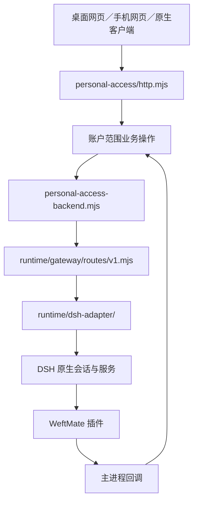

# 架构与加载链

本文按源码说明启动、请求、运行时和数据的连接关系。产品决定见 [DECISIONS](DECISIONS.md)，客户端字段与错误见 [CLIENT_API](CLIENT_API.md)；代码、CI、安装验收与日用认可的层级见 [项目地图](../PROJECT-MAP.md) 第 4 节。源码存在不等于安装版或线上部署已验收。

## 1. 桌面与个人宿主启动

入口是 [src/main.mjs](../src/main.mjs) 的 `bootstrap()`。它组装配置、凭据、模型调度、运行时、个人访问服务、记忆、更新与窗口；不是所有请求都直接由这个文件处理。

1. [desktop-config.mjs](../src/desktop-config.mjs) 处理安装版配置，[host-mode.mjs](../src/host-mode.mjs) 解析个人宿主、桌面窗口、监听端口和隔离目录条件。
2. 主进程创建 `DshWebRuntime`，明确使用产品固定的 DSH（助手运行时）产物。开发树与安装包的产物来源不同，固定依赖身份由 [dsh-pin.json](../tests/contract/dsh-pin.json) 与构建产物清单约束；不能借用本机另一份源码判断安装版能力。
3. 个人宿主通过 `startPersonalHost()` 启动运行时，迁移模型路由并恢复会话绑定。`ensureSharedRuntime()` 管理同一运行时实例，不为每个模型另起一套 DSH。
4. 主进程用 `createPersonalAccessBackend()` 组装运行时回调，用 `createPersonalAccessService()` 恢复账户私有存储并组装业务服务。工厂恢复存储，`start()` 才开始监听环回地址。
5. 桌面模式先由 [personal-desktop.mjs](../src/personal-desktop.mjs) 创建主窗口，[desktop-startup.mjs](../src/desktop-startup.mjs) 显示本地「准备中」页面。凭据初始化与首窗绘制并行；没有模型凭据和路由、没有备份恢复或手机运行组件的新目录，同时启动同一个 DSH。已有凭据和旧版迁移仍按原顺序执行。个人服务就绪后，同一个窗口接入原有鉴权和个人网页。首次启动仍须等 Chromium 将主密钥写入 `Local State`，通过持久密钥认证、刷盘和关闭文件后才允许保存凭据；失败时保留错误说明，不开放业务页面。托盘启动保持隐藏，准备期间关窗仍收进托盘。无窗口模式保留同一宿主服务；非个人宿主分支加载 DSH 自身界面。
6. 退出由 `before-quit` 复用同一个异步收尾过程，关闭个人服务、后台工作、记忆与运行时后才放行；运行日志由 [host-log.mjs](../src/host-log.mjs) 记录生命周期与安全诊断。

安装包的运行时组件、记忆启用条件和验收缺口分别见 [记忆运行时说明](../scripts/memory-runtime/README.md) 与 [MEMORY](MEMORY.md)。内置组件不等于全新安装已自动启用记忆。

## 2. 客户端请求到原生执行

| 层 | 实际职责与入口 |
|---|---|
| 个人 HTTP（网页传输协议）服务 | [personal-access/index.mjs](../src/personal-access/index.mjs) 组合存储、鉴权和操作模块；[http.mjs](../src/personal-access/http.mjs) 分发 `/personal/v1` 请求；记忆与健康另有专用处理模块 |
| 账户业务 | `authentication.mjs`、`sessions.mjs`、`commands.mjs`、`approvals.mjs`、`user-questions.mjs`、`tasks.mjs` 等在原账户范围内处理授权、持久请求与结果投影；命令受理不代表执行完成 |
| 宿主回调 | [personal-access-backend.mjs](../src/personal-access-backend.mjs) 检查模型、原会话和预设，使用主进程传入的 `stageOneGateway` 访问运行时；保持原 `requestId`、`receiptId` 和会话绑定 |
| 内部网关 | [weftmate-host.mjs](../src/plugins/weftmate-host.mjs) 挂载 [gateway/index.mjs](../src/runtime/gateway/index.mjs)，由 [routes/v1.mjs](../src/runtime/gateway/routes/v1.mjs) 处理 `/weftmate/api/v1`；旧 `/weftmate/*` 接缝由 `legacy/` 保留 |
| DSH 适配 | [sessions.mjs](../src/runtime/dsh-adapter/sessions.mjs) 投影历史，[session-lifecycle.mjs](../src/runtime/dsh-adapter/session-lifecycle.mjs) 管理原生创建／恢复／分叉／交接；任务、审批、目标和工具仍使用 DSH 服务 |
| 插件到主进程 | [dsh-web-runtime.ts](../src/dsh-web-runtime.ts) 提供 IPC（进程间通信）回调，传递凭据请求、个人工具、记忆与来源核对；不是另一个客户端公开接口 |

`/personal/v1` 是账户业务边界，`/weftmate/api/v1` 是内部运行时边界，两者不能互换。客户端通过原请求身份核对不确定结果；断流、超时或进程结束不能自动解释为任务成功，也不能自动重发有副作用的命令。

## 3. DSH 产物、配置与工具

[dsh-web-runtime.ts](../src/dsh-web-runtime.ts) 负责生成或修复运行档案、复制插件与适配模块、叠加模型路由及安全配置、启动子进程、读取就绪地址、管理退出和恢复。`writePluginAssets()` 将 `src/plugins/` 以及 `src/runtime/gateway/`、`dsh-adapter/` 等复制进运行档案；插件实际从该副本加载，修改源文件后必须通过已有构建／启动链交付。

个人宿主组合使用产品自己的预设及插件；普通命令、文件、搜索、浏览器、上下文压缩、子任务、调度与审批优先沿 DSH 原生能力（D2、D87）。WeftMate 增加账户、设备、项目、模式、记忆和产品呈现，不另造一套通用执行器。

- [weftmate-personal-desktop.mjs](../src/plugins/weftmate-personal-desktop.mjs) 把工具生命周期接到账户与项目策略；[personal-work-mode.mjs](../src/plugins/personal-work-mode.mjs) 判断对话能否执行该工具；[personal-approval-policy.mjs](../src/plugins/personal-approval-policy.mjs) 处理原风险与审批规则。
- [work-and-chat.mjs](../src/personal-access/work-and-chat.mjs) 保存模式与项目绑定。D92 只允许工作操作电脑；切换卡片确认工作范围，不能代替具体工具批准。
- 模型配置和凭据由主进程管理；运行时通过专用 IPC 获取所需秘密。模型服务与按会话选模见 [model-services.mjs](../src/personal-access/model-services.mjs)、[account-models.mjs](../src/personal-access/account-models.mjs) 与 CLIENT_API 第 3.10 节。

## 4. 逻辑对话、历史与记忆

逻辑对话链为 [chat-identity.mjs](../src/personal-access/chat-identity.mjs) → [chats.mjs](../src/personal-access/chats.mjs)／[chat-timeline.mjs](../src/personal-access/chat-timeline.mjs) → 原生历史投影。`chatId` 聚合执行段，`sessionId` 仍是原执行与记忆来源。原主聊天入口按 D92 取消，底层 `kind:main`、接力、生命周期保护与默认后台投递为兼容保留；细节见 [IA_MAIN_CHAT](IA_MAIN_CHAT.md)。

历史分三层：DSH 原生日志是执行来源；宿主公开历史缓存可重建；逻辑时间线建立渐进内存索引并提供签名分页。缓存命中不代表首次无缓存读取已有物理范围保证。工具原始详情仍从原日志按需读取。

记忆调用链为 [weftmate-personal-memory.mjs](../src/plugins/weftmate-personal-memory.mjs) → 运行时 IPC／主进程回调 → [memory-ingestion.mjs](../src/personal-access/memory-ingestion.mjs) 与 [personal-memory/](../src/personal-memory/) → 独立 MemoWeft Core（记忆核心）进程。形成、召回和管理分别走对应入口，不能把插件注入当成真人原话重新形成。

记忆管理器按账户隔离目录、Core 进程、来源与处理队列，模型目的地按账户及原会话配置核对；配置缺失时不能宣称记忆就绪。删除契约覆盖修订链、来源与派生副本，聊天原话默认保留（D16、D33）；当前实现与安装验收边界以 MEMORY 和项目地图为准。

## 5. 客户端共用与跨端

| 客户端／服务 | 加载入口与分工 |
|---|---|
| 桌面与远程网页 | [personal-access-ui/index.mjs](../src/personal-access-ui/index.mjs) 提供固定静态资源；`personal-access-ui/` 管呈现，[ui-core/](../src/ui-core/) 管共用状态、请求、历史与动作 |
| 手机网页与安卓内置网页 | [apps/mobile-ui/www/](../apps/mobile-ui/www/) 保留页面母版；共用功能副本由 [build-ui-core.mjs](../apps/mobile-ui/src/build-ui-core.mjs) 从 `src/ui-core/` 生成，修改源头后生成 |
| 安卓原生 | [NativeActivity.kt](../apps/android/app/src/main/java/com/memoweft/weftmate/mobile/NativeActivity.kt) 继承 [HybridActivity.kt](../apps/android/app/src/main/java/com/memoweft/weftmate/mobile/HybridActivity.kt) 的现役接线；[Network.kt](../apps/android/app/src/main/java/com/memoweft/weftmate/mobile/Network.kt) 限定业务路径，原生聊天由 `NativeChatModel` 管理 |
| 苹果三端 | [apps/apple/UI/](../apps/apple/UI/) 共用呈现与模型，[WeftMateCore](../apps/apple/Packages/WeftMateCore/) 共用协议、存储与逻辑；`iOS/`、`macOS/`、`watchOS/` 承担平台行为 |
| 同步与离线 | [personal-sync/](../src/personal-sync/) 保存账户与设备来源事件；[personal-offline/](../src/personal-offline/) 管加密副本、删除代次与补交。同步事实不重新派发电脑动作 |
| 云与中继 | [personal-cloud/](../src/personal-cloud/)、[personal-relay/](../src/personal-relay/) 接 [services/cloud/](../services/cloud/)；账号、设备目录、连接、密文暂存与备份按各自协议工作。源码与实际部署须分别核验 |

手机不连电脑的聊天与轻量记忆沿其独立路径；电脑任务仍绑定确定电脑及项目，不因另一台在线自动迁移。协议见 CLIENT_API、[CLOUD](CLOUD.md) 与 [CLOUD_BACKUP](CLOUD_BACKUP.md)。

## 6. 连接器与其他账户服务

[personal-connectors/](../src/personal-connectors/) 使用固定 DSH 的 MCP（模型上下文协议）客户端处理连接、发现与调用；WeftMate 负责隔离进程、账户配置、凭据与审批。`load_tools` 仍由 DSH 提供，不另建模型工具调度。内置邮件与日历入口见 [service-server.mjs](../src/personal-connectors/service-server.mjs)，依赖和许可见 [ST7B_DEPENDENCIES](ST7B_DEPENDENCIES.md)。

第三方凭据与模型密钥复用主进程加密库；[vault.mjs](../src/personal-connectors/vault.mjs) 按账户与连接器划分名称空间，配置和列表不返回真实值。工具结果是外部资料，不能取得用户指令或执行授权。具体请求、默认审批和错误边界见 CLIENT_API 连接器一节。

健康、备份与更新分别由 [personal-health/](../src/personal-health/)、[personal-backup/](../src/personal-backup/)、[personal-cloud-backup/](../src/personal-cloud-backup/)、[personal-update/](../src/personal-update/) 承担，个人服务只组合其账户接口。设计母版在 `design/tokens/`、`design/icons/`，发布入口在 `scripts/release/`；完整源码入口表见项目地图第 7 节。
