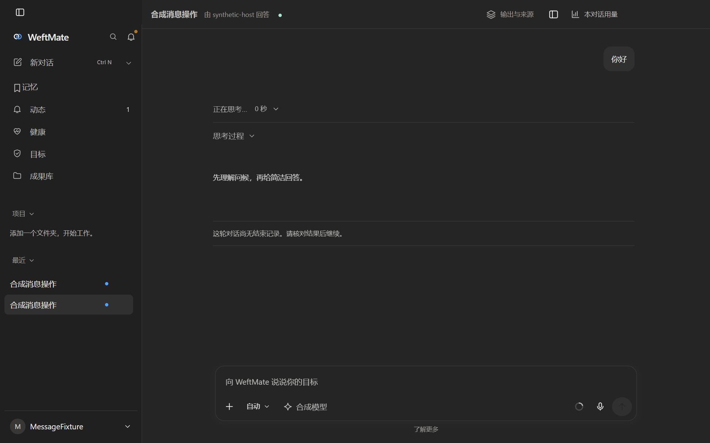
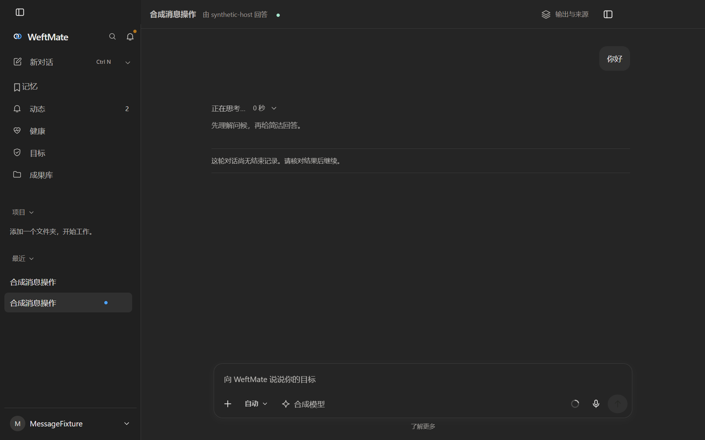
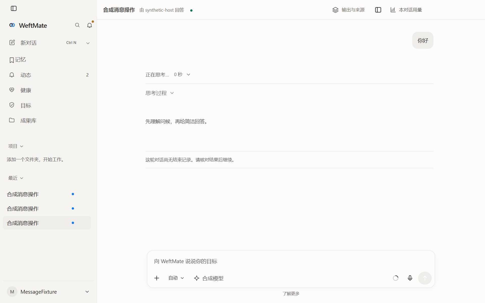
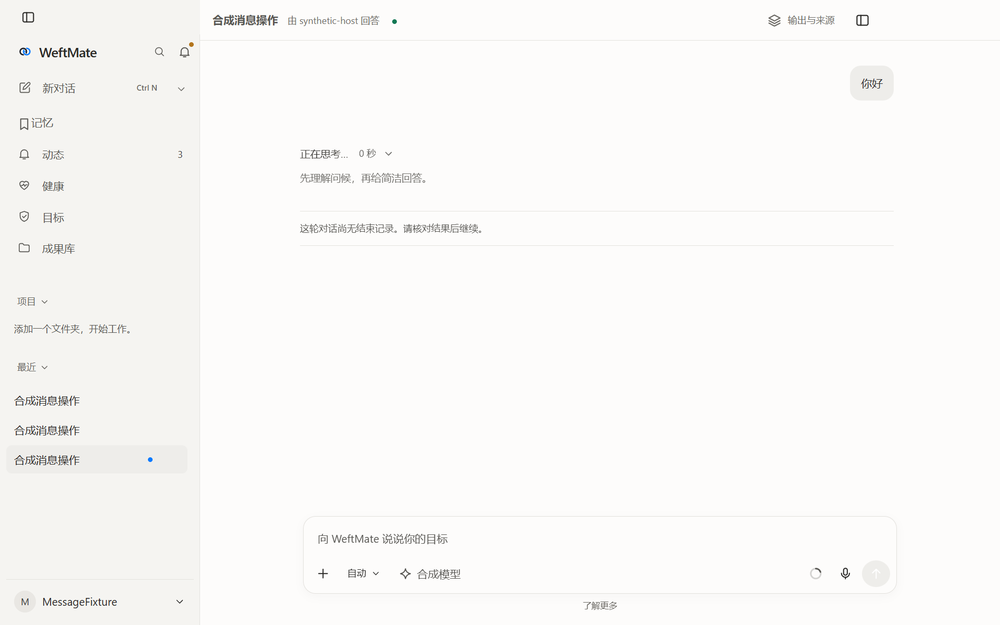

# 电脑对话打磨验收

全部截图和录屏来自隔离身份、合成账号及合成对话；MiMo 私人截图与安装资料未提交。

| 项目 | 结果与实现 |
|---|---|
| 回到底部 | 用实际 `scrollHeight - clientHeight - scrollTop` 决定显示，阈值为视口 15% 且至少 48px；圆形按钮绝对定位，只淡入淡出，点击平滑回底并恢复跟随。空对话、短对话有回归。手机网页和侧聊共用此逻辑。 |
| 等待、思考 | 删除等待说明和未知用时。只有一行当前状态，纯思考由这行展开，不再嵌套第二行标题；保留展开、收起、隐藏偏好及手动收起状态。 |
| 思考颜色与间距 | 使用次要文字色，段落外距 4px、内距 0；工具操作不再占思考标题与正文之间的一整行。深浅色均已核对。 |
| 输入框 | 比较过 FLIP 与固定底部，选择后者。首条发送时输入框位移从约 253px 降至 0，标题只淡出。 |
| 工作选择行 | 替换反复测量和写入高度的通用折叠，改成 `grid-template-rows: 0fr ↔ 1fr` 与透明度；内容保留、裁切，收起时不能获得焦点，结束后高度为 0。输入框固定也消除了开合时的整块重新居中。 |
| 原生窗口 | 不调用 `setViewportSize` 或视口模拟。900×700、1280×800、最大化、还原及连续原生调整大小均核对每帧根节点边界；面板开关与首条发送一并录帧。 |
| 顶栏 | 删除对话用量入口，设置保留按对话排行；右侧只留顶栏开关，放大与窄窗口也可点击，原快捷键保留。 |
| 内部建议提示 | 未复现 `No new suggestions`。建议生成使用独立 `modelCompletion`，只解析返回的建议 JSON，不向对话追加思考；现有源码没有该固定提示。没有按词句删除用户可能需要的模型原始思考。 |

使用 UI-MIMO-MEASURE 的同一个 `measurement.mjs`，采集 rAF 帧间隔、长任务、布局偏移和 CDP 变化帧。以下是 1280×800 原生窗口的数据；流式回放包含思考、60 次全文快照、结束及三次建议条变化。

| 数据 | 修前 | FLIP 试验 | 固定底部 |
|---|---:|---:|---:|
| 首条发送输入框位移 | 253px | 253px，transform 补间 | 0px |
| 首条发送全部布局偏移，深 / 浅 | 0.1854 / 0.1864 | 0.2071 / 0.2088 | 0.0484 / 0.0555 |
| 流式、结束、建议段 CLS，深 / 浅 | 0.000313 / 0.000312 | 0.000312 / 0.000312 | 0.000312 / 0.000314 |
| 上述流式段长任务 | 0 / 0 | 0 / 0 | 0 / 0 |

CLS 排除近期输入造成的偏移，表中的“全部布局偏移”不排除输入。面板展开和原生窗口调整产生的正常几何变化没有被当成流式稳定性改善。固定底部最终完整录帧首条发送最大 33.4ms / 8.6ms（深色一次超过 25ms）；流式段最大 16.7ms / 8.9ms，没有超过 50ms 的长任务。这里不把合成宿主验收当作真实模型网络端到端验收。

另跑 #742 的下一帧全文、跟随与上翻锚点回归：165 条清单全文正确，底部最大间隙 0px，上翻锚点漂移 0px。一轮窗口录帧中的 346 张变化帧没有全屏空白或深色露白，逐帧几何断言通过。

MiMo 独立资料目录能启动，但资源准备 / 解压尚未进入可对话页面，因此本轮使用既有参考截图及打包实现核对布局；没有取得同条件的新 MiMo 性能数字。静态实现中可见滚动位置差值、逐帧追随及用户中断判断；本包只借鉴做法，没有复制实现。

本机已通过 68 条相关测试，覆盖滚动、过程、建议、工作模式、用量、手机资产，真实 Electron 主侧并行、面板及过程回归，以及类型检查和公开检查。额外尝试的原生 DSH 时间线测试缺少固定运行时（主仓的运行时联接也已失效），本地没有通过；未改动运行时来绕过它，交给 CI 的固定依赖环境验证。

本包的产品变更都在已有界面资源中，没有宿主接口变化或新增运行时界面文件，可走 `release-ui`；实际发布仍由发布脚本核对当前安装基线和 main。

| 修前深色 | 修后深色 |
|---|---|
|  |  |

| 修前浅色 | 修后浅色 |
|---|---|
|  |  |

[原居中空对话](chat-polish/centered-empty.png) · [固定底部空对话](chat-polish/bottom-empty.png) · [FLIP 首条发送录屏](chat-polish/flip-first-send.mp4) · [固定底部首条发送录屏](chat-polish/bottom-first-send.mp4)
