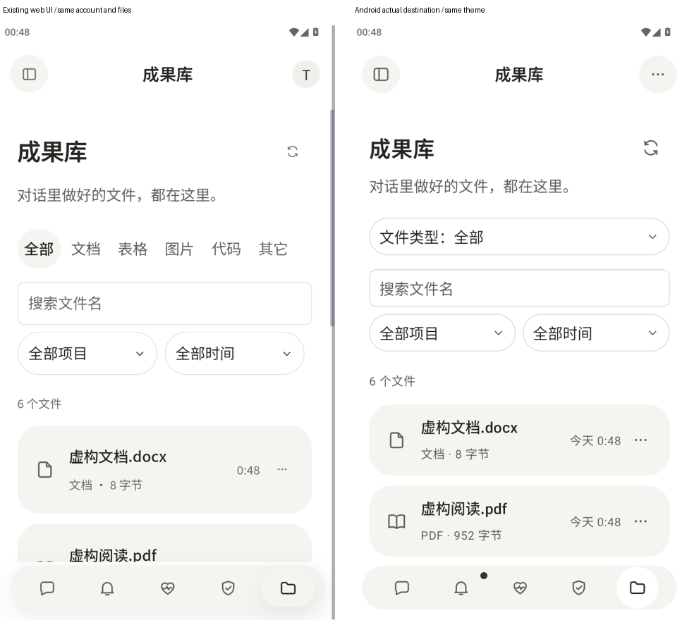
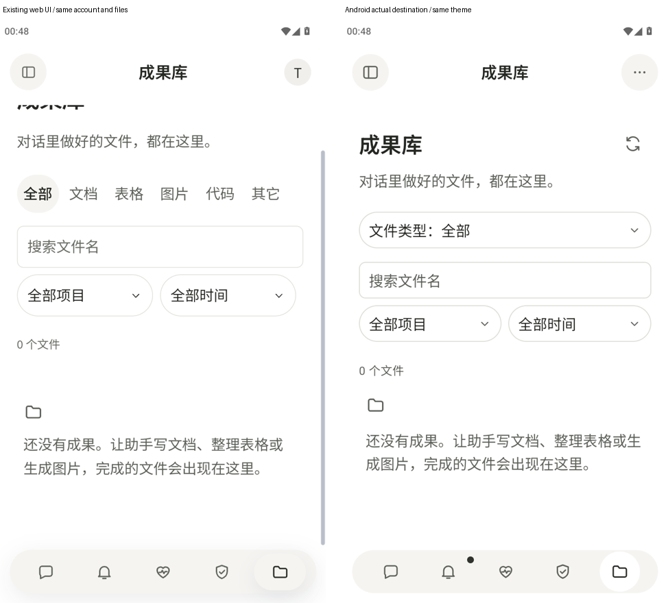
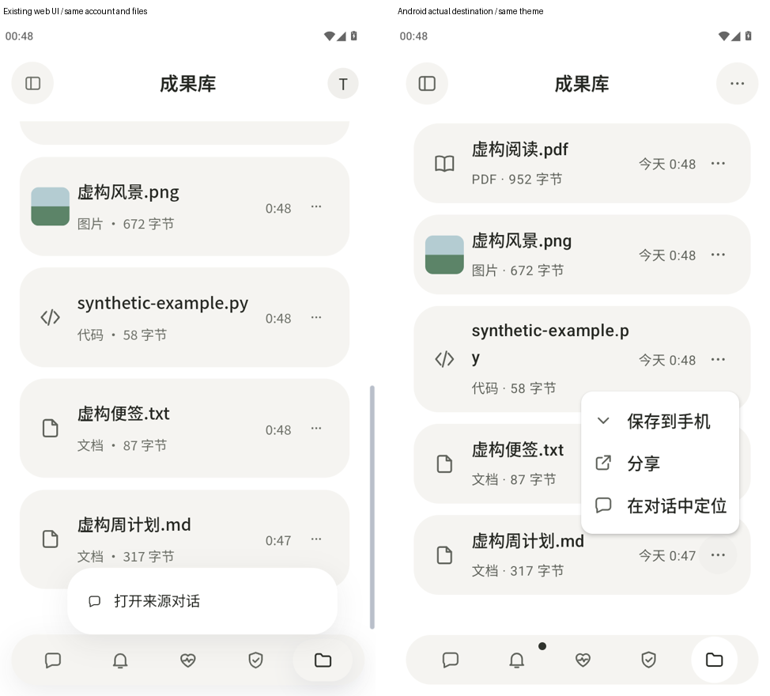
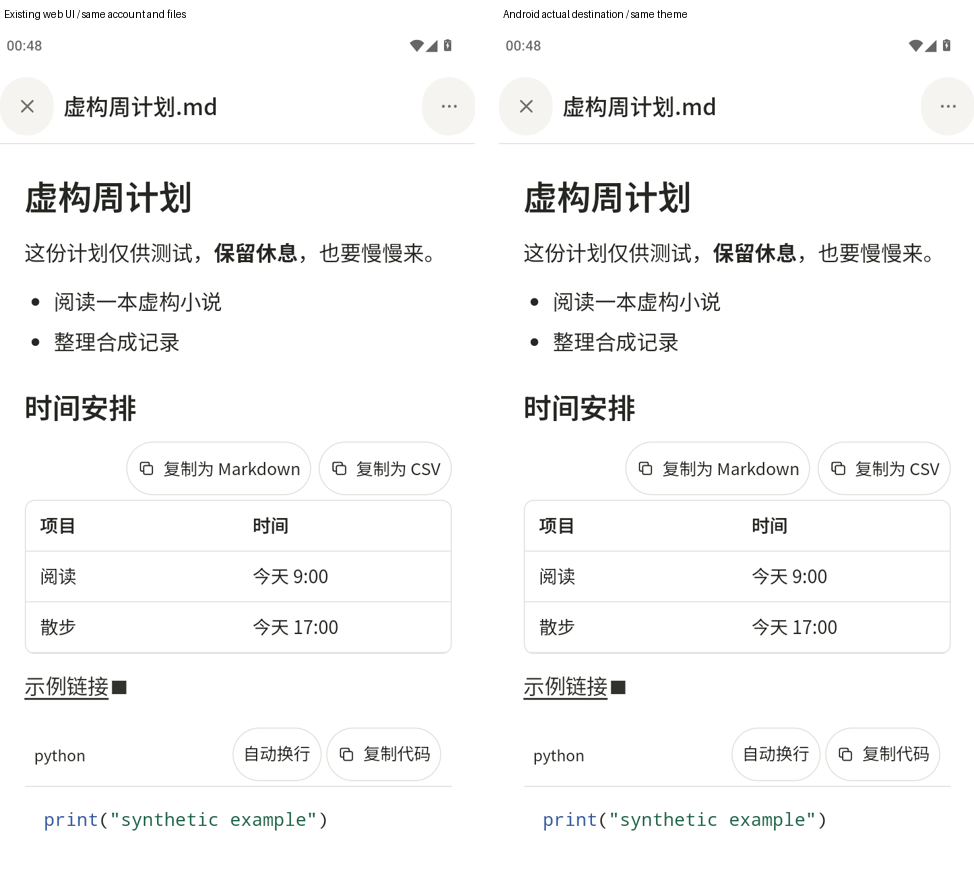
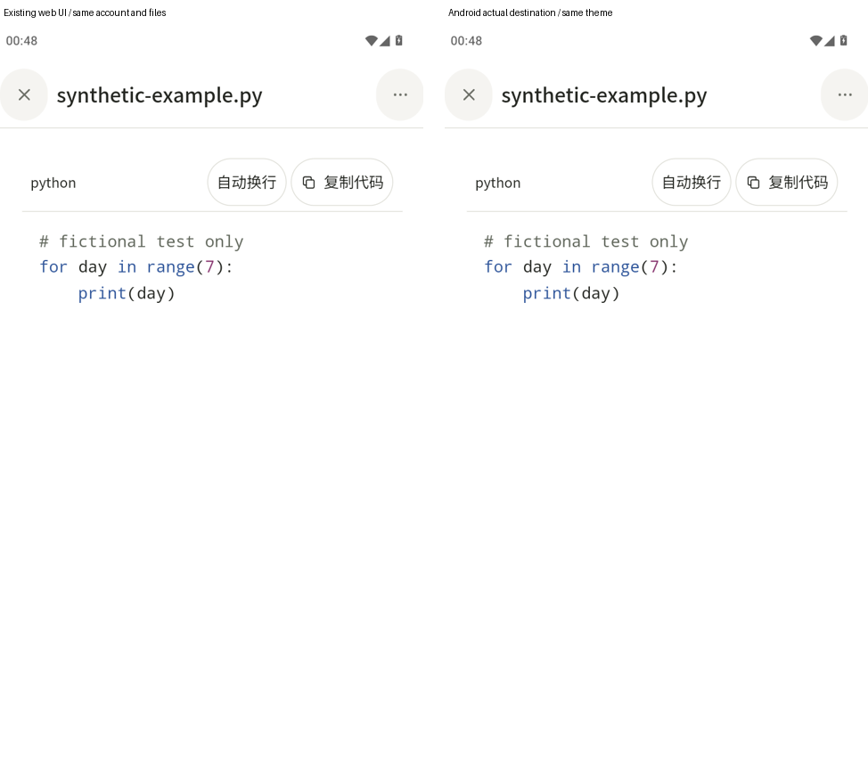

# AND-7 · 安卓成果库与统一文件查看

成果库使用原生列表、文件名搜索、文件类型／项目／时间筛选，顺序和分页沿 `/personal/v1/library`。每行整体打开文件，右侧只有一个操作菜单；没有实际的多个不同版本就不显示历史。聊天成果、草稿附件和已发送附件共用同一文件入口；图片、纯文字、PDF 和其它类型进入原生全屏查看，Markdown／代码自动进入原网页文件屏，查看页没有聊天输入框。

图片支持拖动、缩放和双击；纯文字可以滚动和选择复制。Markdown（标记文本）与代码采用调度方允许的第二种方案：直接打开原网页查看，保留带边框和粗体表头的横向表格、复制为 Markdown／CSV（逗号分隔数据）、代码语言名、复制代码、自动换行、语法着色及原有列表缩进。聊天 Markdown 附件也读取受认证／账号隔离保护的原始字节，交给同一原网页渲染器；不再把简化的原生渲染作为这两类的默认查看。PDF（便携文档）使用系统 `PdfRenderer`，一次只解码当前页，上一页／下一页与缩放共用图片手势。

保存使用 Storage Access Framework（系统文档选择框）的 `ACTION_CREATE_DOCUMENT`。分享和用其它应用打开使用独立 `FileProvider`（私有文件提供器），仅授予目标 URI（资源标识）的临时读取权；没有写入、持久或整目录授权，没有新增存储权限。原始内容沿原认证、证书固定和接口路径校验读取，文件在应用私有缓存，退出／切号时清除；网页拿不到本机文件路径。

现有电脑接口的边界：成果库预览可返回图片、UTF-8（文字编码）文本及 PDF 内容；旧版核验成果有下载接口。电脑原生 Office（办公文档）／压缩包和超过预览上限的文件没有通用字节导出入口，本包遵守安卓范围，没有新增电脑接口；这类成果显示文件信息和具体说明，导出动作禁用。安卓本地／已同步的原始二进制附件可以保存、分享和交给其它应用。这个接口缺口明确列在交付和 PR（拉取请求）中，不用合成成功掩盖它。

全部内容、账号、文件及电脑为虚构测试资料，监听随机回环端口；没有模型请求，没有访问日用数据、18186 或线上 WeftMate 服务。系统文档／分享面板由测试替身接收，未操作真实系统窗口。

最终四组完整设备流程通过，128张原始整屏图状态栏／顶栏色差全为0。`required.json` 为已通过的完整必过组，`screenshots.json` 和 `system-bars.md` 由原始设备截图生成，`pairs/` 左侧为安卓壳内原网页、右侧为本包实际入口（Markdown／代码为保留网页），使用同一合成账号、同样文件和主题。浅色与原网页并排；深色按 [控件规范取值](dark-control-reference.json) 和生成的取值预览逐项核对，不以旧网页深色为参照。已合入主线 d254f387（包含 AND-4 #276、多电脑 #285 与 AND-5 #288），最终入口与局部磨砂下四组重新拍摄。15个深色令牌逐项一致；菜单打开前后系统图标区域平均色差为0。

真机待确认：保存位置选择、分享面板和其它应用打开各点一次；状态栏／底部手势条、刘海圆角、系统字体放大以及真实键盘收起。MuMu（安卓模拟器）底部系统导航区域高度为 0，不把未显示的手势条算作验收通过。

本轮合主线并修订回退后：离线调试包／界面测试包构建通过，Android JVM（Java 虚拟机）115／0（其中本包11项），`tests/android-route-inventory.test.ts` 与 `tests/mobile-android-bridge.test.ts` 共8／0，类型检查通过；公开卫生与最终四组报告见 `validation.json`。按第10条新口径，本轮没有重跑完整必过／固定运行时／五文件手机全量。

历史门禁（2026-10-13、主线合并前，不冒充本轮结果）：完整必过 1954 通过、0 失败、14 个原有跳过（341 文件）；固定 DSH（助手运行时）集成 241／0／0（35 文件）；手机交互五文件 115／0；历史 Android JVM（Java 虚拟机）103／0、离线调试包与界面测试包构建通过；路由自动比对 3／0、类型检查和公开卫生检查通过。设备完整文件流程已跑过 360／390 × 浅／深四组，包含真实认证、原始文件校验、PDF 翻页、图片双击、对话定位和附件进入、创建文档与只读分享请求、退出后失效及缓存清理。新颜色与局部磨砂、实际分享选择器和离线缓存列表均已补验通过，分组时长与系统栏保护断言见 [device-tests.json](device-tests.json)。

Markdown／代码的最终整屏证据是实际自动回退后的网页，不标成原生渲染。深色规范只验收本包原生页面；旧网页回退屏维持原有颜色，不冒充已经改为中性灰。

与网页对比的阅读口径：`pairs/light-*` 左边原网页、右边原生，账号、数据与主题相同；`pairs/dark-*` 左边为控件规范取值参考、右边原生。截图是整屏原图的等比并排；MuMu 未改变物理显示，截图两侧均使用同一合成逻辑宽度；取值参考明确标为规范参考，未冒充真实页面。

一致：标题、说明、搜索、类型／项目／时间条件、数量、服务端文件顺序与卡片信息。

故意不同：网页六项类型是直接点的一排，原生按控件规范收进带当前勾选的下拉菜单；保留全部条件。此差异由 Claude 请本人选择，本包按调度要求保持下拉。

故意更好：整行直接打开同一文件入口，图片、纯文字与 PDF 使用原生手势和系统导出。

仍差：原生没有桌面网格与复制电脑路径；手机原网页本来不显示这两项，原网页完整入口仍保留，无手机功能缺失。

一致：说明成果来自对话，并给出让助手完成文件的下一步。

故意更好：没有电脑的账号得到可访问的空状态，不把电脑缺席说成故障。

仍差：无；底部系统手势条受现有模拟器不可见的限制，单独列为真机确认，不把它算成已验收。

一致：保留来源对话入口，只有实际存在多个不同版本才显示历史。

故意更好：补齐系统保存与分享，规范要求每项 44 点按高度、项目图标、12 圆角及深色磨砂。

仍差：电脑 Office／压缩包成果缺少现有通用字节下载接口，本包仅改安卓，不能补电脑接口；准确原网页文件入口保留。安卓原始附件可以导出。

一致：两边均为原网页文件屏，表格边框、粗体表头、横向滚动、复制为 Markdown／CSV、代码语言名／复制／换行／着色、列表缩进全部沿原实现。

故意更好：这两类渲染保持原样；从原生成果库和聊天文件入口自动进入该屏，关闭后回到原生。

仍差：这两类尚未原生化，本包选用明确允许的整屏网页回退，原有功能没有降级；原生重做留后续。

一致：两边均为原网页代码查看，语言名、自动换行、复制代码与语法着色保留。

故意更好：这类渲染不改样子；从原生列表自动进入，返回原生列表。

仍差：代码查看尚未原生化，保留完整旧屏，不以缺少操作的纯文字代替。

深色对照：[列表](pairs/dark-library-list.png)、[行菜单](pairs/dark-row-menu.png)、[空状态](pairs/dark-library-empty.png)、[查看页菜单](pairs/dark-viewer-menu.png)。

一致：背景、字色、强调色、分隔线、选中底及危险色逐项核对 [控件规范取值](dark-control-reference.json)，自动报告见 `dark-token-audit.json`。

故意更好：按本人要求使用中性灰磨砂，模糊只作用于浮动面板的局部背景，不给滚动文件内容加模糊；滚动期间暂停模糊采样，旧系统退回实色。

仍差：旧网页深色尚未改为该规范，因此不拿它验收颜色；真机系统栏与真实系统面板留待本人确认。

界面规则自查：整行打开、右侧只有「…」；进入成果库隐藏对话专属顶栏动作；一个小刷新入口；筛选当前项有勾；加载骨架、可恢复错误和人话空态；按钮点按区至少 44、图标不附文字；颜色取令牌、浅深可读。系统栏逐张数值见 [system-bars.md](system-bars.md)，每张同时注明 MuMu 原有系统主题、Android 15 和底部系统导航不可见。真机底部手势条验收仍明确留给本人。

iPhone（苹果手机）差异按现有 `PhoneLibraryView.swift` 与 `ConversationAttachmentView.swift` 核对：安卓搜索沿网页的输入后自动筛选，iPhone还有独立搜索按钮；安卓保留网页已有的项目／时间条件，当前iPhone页只有类型条件。两端都采用全屏、圆形关闭、中间省略文件名、菜单内保存／分享和来源对话。iPhone用系统 Quick Look（快速预览）；安卓用原生图片手势、可选文字和逐页 `PdfRenderer`，其它类型交给外部应用。Markdown／代码（包括复杂公式与图表）直接进入准确原网页文件屏。按后续口径，本包以网页浅色及中性灰控件深色为验收基准，iPhone并排图为可选，未另制作。

复验命令：`pwsh -File tests/integration/and-7-heavy.ps1 -Mode gradle`（离线JVM与调试／测试包）；`pwsh -File tests/integration/and-7-mumu.ps1`（自动占本包重活名额及模拟器锁、四组、卸载与断开）；当前按第10条只跑相关文件，不再本地运行完整组；此前完整组结果仅作为历史记录保留。相关命令：`node --test tests/android-route-inventory.test.ts tests/mobile-android-bridge.test.ts`、`npm run typecheck`、`node .github/scripts/public-hygiene.mjs`。`python tests/integration/and-7-evidence.py` 生成原始截图清单、逐张色差与并排图，`python tests/integration/and-7-dark-tokens.py` 核对15个令牌。没有新增必过组测试文件依赖vendor；Android JVM测试沿离线Gradle运行。
