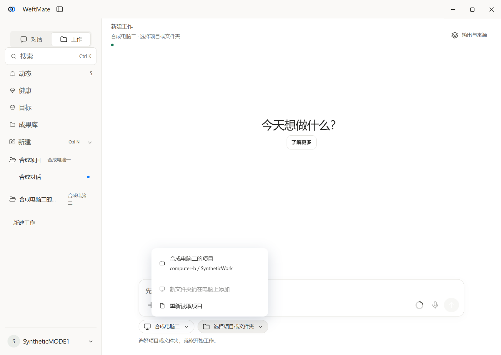
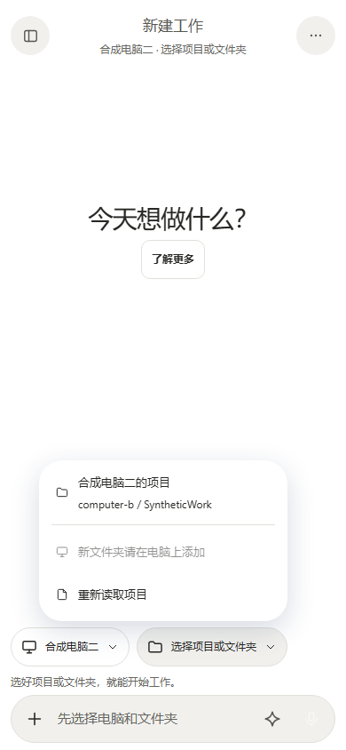

# MODE-1 · 按本人2026-10-14 10:20意见修改

先看两张输入区选择的新图：

## 四处变化

- 公开资料 `web_search/web_fetch` 留在对话，不要求项目，不弹模式卡片；交互浏览器点击、登录、下载仍需要工作。
- 原“小纬”历史是普通列表项；底层 `kind:main/mainChatId`、旧接口、历史聚合和后台默认投递保留，不再生成空替代入口。底层主聊天暂有生命周期保护，界面不显示其不支持的删除／归档等动作。
- 侧栏顶部 Segmented（分段选择控件）切“对话／工作”，同一块列表显示所选模式，工作按项目分组；新建跟随当前格，偏好按账户保存，通知打开会话切到实际模式。
- 工作电脑／项目的轻量选择在桌面输入框下方、手机网页紧接输入框上方；顶栏只留身份小字。转换卡片继续原 ChoiceList（卡片选择控件）和原具体操作审批。

定义、已定规则和兼容边界见 [WORK_AND_CHAT](../../../docs/WORK_AND_CHAT.md)，接口见 [CLIENT_API](../../../docs/CLIENT_API.md)。私有参考图没有复制到仓库，使用项目自己的图标、配色、排版和控件。

## 证据与范围

[electron-report.json](electron-report.json) 使用两个独立合成电脑、合成模型、随机端口和临时目录，运行真实 Electron（桌面程序框架）、固定 DSH（助手运行时）、内容认证、审批和文件操作。云目录与通道凭据交换是本机合成替身，没有连接正式服务器。

电脑窗口用专属原生句柄捕获；手机网页为390×844／360×780浏览器内容视口。`systemBarsVerified:false`，没有把网页图写成原生系统栏／键盘／手势验收。测试窗口不抢本人桌面焦点，对本包测试进程关闭窗口遮挡导致的后台节流，保持渲染观察；没有操作本人窗口或改变产品的后台轮询规则。

76张独立图片覆盖1200／480电脑、390／360网页、浅深色：

| 场景 | 代表图 |
|---|---|
| 对话格选中、普通历史列表 | [电脑1200浅](desktop-1200-light-sidebar-chat.png) / [手机360深](phone-360-dark-sidebar-chat.png) |
| 工作格选中、项目分组 | [电脑480深](desktop-480-dark-sidebar-work.png) / [手机390浅](phone-390-light-sidebar-work.png) |
| 原“小纬”普通行和原历史 | [电脑1200浅](desktop-1200-light-original-history.png) / [手机360深](phone-360-dark-original-history.png) |
| 输入区电脑菜单打开 | [电脑1200浅](desktop-1200-light-computer-menu.png) / [手机390浅](phone-390-light-computer-menu.png) |
| 输入区项目菜单打开 | [电脑480深](desktop-480-dark-new-work.png) / [手机360深](phone-360-dark-new-work.png) |
| 转换卡片 | [电脑1200浅](desktop-1200-light-switch-card.png) / [手机360深](phone-360-dark-switch-card.png) |
| 同段历史已进入工作 | [电脑480深](desktop-480-dark-working.png) / [手机390浅](phone-390-light-working.png) |
| 第二台电脑的工作 | [电脑1200浅](desktop-1200-light-second-computer-work.png) / [手机360深](phone-360-dark-second-computer-work.png) |
| 无在线电脑卡片 | [电脑480深](desktop-480-dark-offline-card.png) / [手机390浅](phone-390-light-offline-card.png) |
| 原逻辑历史转换，无空替代入口 | [电脑1200浅](desktop-1200-light-main-to-work.png) / [电脑480深](desktop-480-dark-main-to-work.png) |

资料查询另由真实固定DSH测试调用 `web_fetch`、经过真实原生桥和来源记录取得合成公开资料，仍为chat、项目为空、无待答审批；页面读取器返回合成资料，不声称访问了真实互联网网站。相同测试验证原主接口继续投递原历史，以及覆盖已有文件时先选工作、后普通风险审批。

## 相关验证

本地只跑相关文件：模式／资料查询／手机单独使用16项，真实固定运行时1项（包含查询、同段转换、后台兼容、拒绝和已有文件风险），原生桥＋HTTP（网页请求）审批38项，界面／共用层／离线138项，逻辑历史与生成资源18项；各组有交集，不相加为独立用例总数。类型、共享资源检查和公开卫生通过。完整测试由同一PR（合并请求）的CI（持续集成）最终轮执行。

云端上一头的两项新增原生审批测试误分入无vendor（运行时依赖）组，因依赖模块缺失失败；已加入固定运行时测试目录，在正确的阻断任务完整执行，没有删断言或加入跳过。

后续云端回归发现，原历史计时夹具、安装包项目列表和手机画廊仍假定启动自动选中旧主历史。夹具现明确打开对应普通历史或工作格，保持原计时、文件落盘和界面断言；相关本机计时两文件通过，云端固定运行时、安装包、中继与画廊通过。新建草稿选文件夹会切工作格，当前身份状态读回解除旧401观察暂停的两项回归，加上共用层最终69项通过。最新完整阻断结果见PR #299，不把局部验证算作完整测试。
